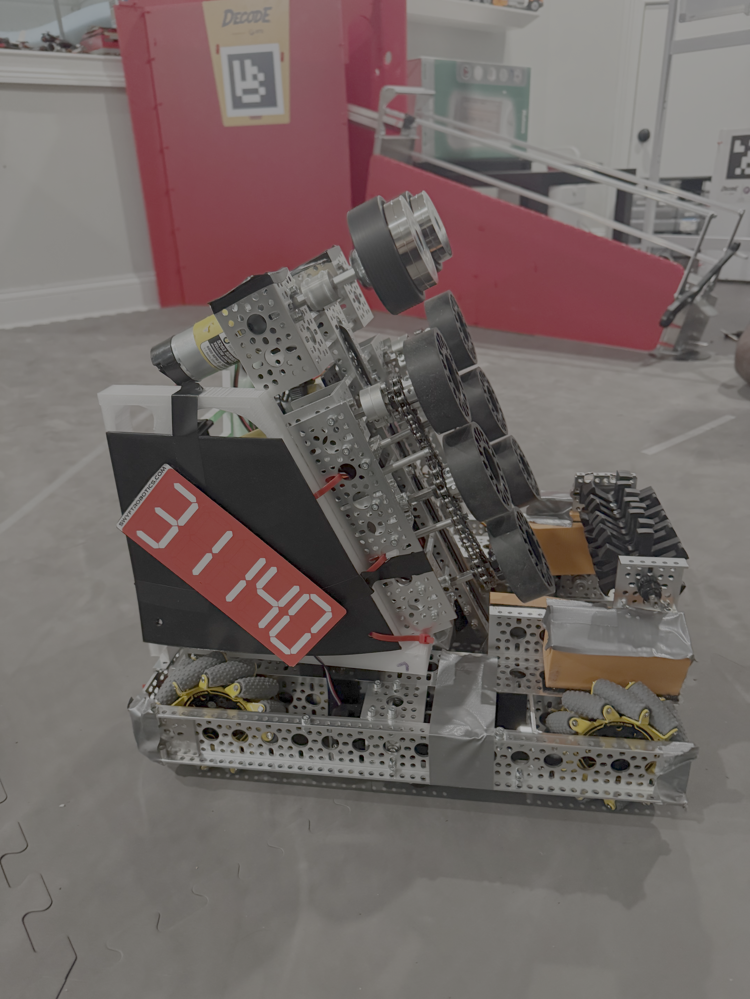

# FTC Team 31140: DECODE Robot Code (2025-26)

This repo has our robot code for **[DECODE™](https://ftc-resources.firstinspires.org/ftc/game)**, the 2025-26 [FIRST Tech Challenge](https://www.firstinspires.org/robotics/ftc) game. If you've never heard of FTC: two alliances (red vs. blue) play 2.5-minute matches on a 12 x 12 ft field. For the first 30 seconds the robot drives itself (autonomous), and for the next 2 minutes we drive it with gamepads. In DECODE, robots pick up balls called *artifacts* and launch them into a goal.

  

## What the robot does
- **Mecanum drivetrain** with 3 odometry wheels, so the robot always knows where it is on the field (at least within an inch or so)
- **Intake + dual-motor launcher** to collect artifacts and shoot them into the goal
- **Autonomous routines** built on [Pedro Pathing](https://pedropathing.com/), a path-following library for FTC
- **Battery voltage compensation**: a full battery shoots harder than a dying one, so the code reads the voltage and adjusts launcher power to keep shots consistent

## Where the code is
Our code lives in [`TeamCode/.../teamcode/pedroPathing/`](TeamCode/src/main/java/org/firstinspires/ftc/teamcode/pedroPathing). Everything else comes from the standard [FTC SDK](https://github.com/FIRST-Tech-Challenge/FtcRobotController), and we didn't touch it.

| File | What it does |
|---|---|
| `redauton` / `blueauton` | Full auto: shoots the preload, grabs and scores 3 rows, then parks |
| `farredauton` / `farblueauton` | Shorter auto: shoots the preload, grabs and scores 1 row, then parks |
| `Constants.java` | Robot measurements and tuned values |
| `Tuning.java` | Pedro Pathing calibration tools (we spent a lot of time here) |

For details on the hardware, the autonomous logic and tuning, check out **[How the code works](doc/CODE.md)**.

## Quick start
Open the project in [Android Studio](https://developer.android.com/studio), connect to the REV Control Hub, and run **TeamCode**. Then pick an autonomous on the Driver Station.

## Links
[DECODE game manual](https://ftc-resources.firstinspires.org/ftc/game) · [FTC docs](https://ftc-docs.firstinspires.org/) · [Pedro Pathing docs](https://pedropathing.com/)
